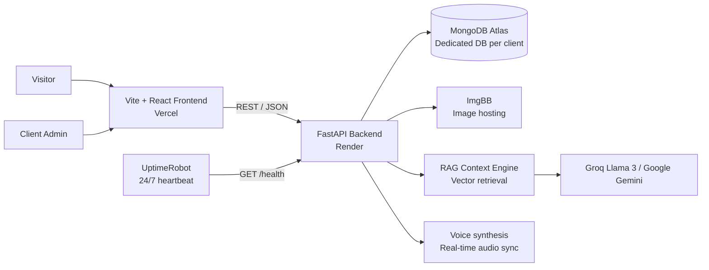

<div align="center">

# AI Digital Twin Portfolio

### A turnkey, production-grade AI Digital Twin & portfolio platform

Client deliverable: **Zainab Hadisha**, Data Analyst
Architected and engineered by **[Md Salik Ubair](https://portfolio-salik-live.vercel.app)**

<br />


</div>

---

## Overview

This repository contains a full-stack **AI Digital Twin Portfolio**: a personal portfolio website paired with an AI twin that answers questions about the owner in text and voice, grounded in the owner's own verified records.

It is delivered as a **turnkey, role-agnostic system**. Today it is deployed for a **Data Analyst** client, Zainab Hadisha, but the architecture is modular by design. The same codebase sustains any professional domain, including Data Analytics, Software Engineering, AI/ML and Product, by changing the content in the admin hub rather than the code.

| | |
|---|---|
| **Client instance** | `client-01-zainab-portfolio` |
| **Role profile** | Data Analyst |
| **Delivery model** | Turnkey: deployed, configured and handed over |
| **Content management** | 100% client-controlled through the private Admin CMS Hub |

---

## Architecture Pillars

### 1. Private Admin CMS Hub
Non-technical clients keep complete control of their portfolio without touching code. Through a secured admin interface the client can manage:

- Portfolio records and projects
- Resume content and downloadable resume
- Skills and experience entries
- Image uploads, hosted through **ImgBB**

Every change is reflected on the live site and in the AI twin's knowledge immediately.

### 2. RAG-Grounded Voice & Chat Digital Twin
The AI twin answers visitor questions using **Retrieval-Augmented Generation**, so responses are grounded in the client's real portfolio data instead of generic model knowledge.

- **LLM context engine:** Groq (Llama 3) with Google Gemini support
- **Vector knowledge grounding:** portfolio content is embedded and retrieved at query time
- **Voice mode:** spoken responses with real-time audio synchronization alongside the chat interface

### 3. Multi-Tenant, Isolated Database Security
Each client instance runs against its **own dedicated MongoDB Atlas database** with separate credentials. Tenant data is isolated by design, which prevents cross-tenant leakage between clients that share the same architecture.

### 4. High-Availability Cloud Setup
- **Backend:** FastAPI (Python) deployed on **Render**
- **Keep-alive:** an automated 24/7 heartbeat monitor through **UptimeRobot** pings the health endpoint so the service stays warm and responsive
- **Frontend:** a zero-latency **Vite + React** application on **Vercel**, served from the edge

---

## System Architecture



**Request flow**

1. A visitor opens the portfolio, served by Vercel.
2. The frontend calls the FastAPI backend on Render over REST with JSON payloads.
3. For twin conversations, the backend retrieves the most relevant portfolio context, sends it with the question to the LLM, and returns text with synchronized audio.
4. The client admin manages all content from the private CMS, which writes to the client's isolated MongoDB database.
5. UptimeRobot calls `/health` on a fixed interval to keep the backend available around the clock.

---

## Project Structure

```text
client-01-zainab-portfolio/
├── backend/                  # FastAPI service (Python)
│   ├── app/                  # Application code: routes, services, RAG engine
│   ├── requirements.txt      # Python dependencies
│   └── .env.example          # Backend environment template
├── frontend/                 # Vite + React application
│   ├── src/                  # Components, pages, admin hub, API client
│   ├── public/               # Static assets
│   ├── package.json          # Frontend dependencies and scripts
│   └── .env.example          # Frontend environment template
└── README.md
```

---

## Quickstart

### Prerequisites

- Python 3.11 or newer
- Node.js 18 or newer, with npm
- A MongoDB Atlas cluster (a dedicated database for this client)
- API keys for Groq and Google Gemini
- An ImgBB API key

### 1. Clone the repository

```bash
git clone https://github.com/Md-Salik-Ubair/client-01-zainab-portfolio.git
cd client-01-zainab-portfolio
```

### 2. Run the backend

```bash
cd backend
python -m venv .venv

# macOS / Linux
source .venv/bin/activate
# Windows (PowerShell)
# .venv\Scripts\Activate.ps1

pip install -r requirements.txt
cp .env.example .env        # then fill in your values
uvicorn app.main:app --reload --port 8000
```

The API is now available at `http://localhost:8000`, with interactive docs at `http://localhost:8000/docs`.

### 3. Run the frontend

Open a second terminal:

```bash
cd frontend
npm install
cp .env.example .env        # then fill in your values
npm run dev
```

The app is now available at `http://localhost:5173`.

---

## Environment Variables

### Backend: `backend/.env.example`

```env
# --- Database ---
MONGODB_URI=mongodb+srv://<user>:<password>@<cluster>.mongodb.net/?retryWrites=true&w=majority
MONGODB_DB_NAME=client_01_zainab_portfolio

# --- LLM providers ---
GROQ_API_KEY=your_groq_api_key
GEMINI_API_KEY=your_gemini_api_key

# --- Image hosting ---
IMGBB_API_KEY=your_imgbb_api_key

# --- Admin security ---
ADMIN_USERNAME=admin
ADMIN_PASSWORD=use_a_long_unique_password
JWT_SECRET=use_a_long_random_string

# --- Server ---
ALLOWED_ORIGINS=http://localhost:5173
PORT=8000
```

| Variable | Description |
|---|---|
| `MONGODB_URI` | Connection string for the client's MongoDB Atlas cluster |
| `MONGODB_DB_NAME` | Dedicated database name for this client instance (tenant isolation) |
| `GROQ_API_KEY` | Groq API key for Llama 3 inference |
| `GEMINI_API_KEY` | Google Gemini API key for embeddings and fallback generation |
| `IMGBB_API_KEY` | ImgBB key used by the admin hub for image uploads |
| `ADMIN_USERNAME` / `ADMIN_PASSWORD` | Credentials for the private Admin CMS Hub |
| `JWT_SECRET` | Secret used to sign admin session tokens |
| `ALLOWED_ORIGINS` | Comma-separated list of frontend origins allowed by CORS |
| `PORT` | Port the backend listens on locally |

### Frontend: `frontend/.env.example`

```env
VITE_API_BASE_URL=http://localhost:8000
```

| Variable | Description |
|---|---|
| `VITE_API_BASE_URL` | Base URL of the FastAPI backend. Use the Render URL in production |

> Never commit real `.env` files. Only the `.env.example` templates belong in version control.

---

## Deployment

### Backend on Render

1. Create a new **Web Service** and connect this repository.
2. Set the **Root Directory** to `backend`.
3. Build command: `pip install -r requirements.txt`
4. Start command: `uvicorn app.main:app --host 0.0.0.0 --port $PORT`
5. Add every backend environment variable in the Render dashboard. Set `ALLOWED_ORIGINS` to the production frontend URL.

### Keep-alive on UptimeRobot

1. Create an **HTTP(s)** monitor pointing to `https://<your-render-service>.onrender.com/health`.
2. Set the monitoring interval to 5 minutes so the service stays warm 24/7.

### Frontend on Vercel

1. Import this repository as a new project.
2. Set the **Root Directory** to `frontend` and keep the **Vite** framework preset.
3. Add `VITE_API_BASE_URL` with the Render backend URL.
4. Deploy. Every push to the main branch redeploys automatically.

---

## Adapting to a New Role or Client

The system is built to be reused, not rewritten:

1. Provision a new MongoDB Atlas database for the new client.
2. Deploy a fresh backend and frontend instance with the new environment variables.
3. Load the new client's records, resume, skills and images through the Admin CMS Hub.

The twin's persona, knowledge and the portfolio itself all follow the content, so the same architecture serves a Data Analyst today and a Software Engineer, AI/ML specialist or Product Manager tomorrow.

---

## Creator & Attribution

The architecture, engineering and deployment of this system were designed and built by **Md Salik Ubair**.

| | |
|---|---|
| **Personal Portfolio** | [portfolio-salik-live.vercel.app](https://portfolio-salik-live.vercel.app) |
| **GitHub** | [github.com/Md-Salik-Ubair](https://github.com/Md-Salik-Ubair) |
| **Collaboration & Inquiries** | [Turnkey AI Portfolio service](https://portfolio-salik-live.vercel.app), or email [mdsalikubair@gmail.com](mailto:mdsalikubair@gmail.com) |

Want an AI Digital Twin portfolio for your own profession? Reach out through the links above.

---

<div align="center">

Built with care by [Md Salik Ubair](https://github.com/Md-Salik-Ubair)

</div>